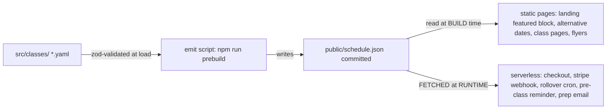

# The Class YAML System — full spec for reimplementation

_Extracted 2026-10-27 from the Brightwater Academy website (this repo) so the pattern can be ported to another project. It is fully self-contained: everything an implementer needs is on this page, including the decision rationale that originally lived in this repo's ADRs. No Astro knowledge is required — the system is a data convention plus a small build step plus a fetch-at-runtime contract._

## 1. The idea

**One class = one YAML file.** The file carries everything a cohort needs: identity (slug, dates, sessions), commercial wiring (Stripe price id, payment link), logistics (location, meeting link, dial-in), and page copy (title, subtitle, details, highlights). Everything else on the site — the landing's featured class, alternative-date rows, class detail pages, checkout, the payment webhook, reminder emails, flyer QR targets, certificate claim links — decomposes from those files. There is no duplication anywhere: a class exists in exactly one place, and every surface derives.



The reason for the intermediate `schedule.json` (instead of "just read the YAMLs in the functions"): **serverless functions in this deployment are transpiled per file and cannot share code or read the repo's filesystem at runtime** — so the build emits the JSON into `public/`, and every function fetches `/schedule.json` from its own origin at request time. One committed artifact is both the build-time input and the runtime API. Copy that contract and the port survives any hosting model.

## 2. Repository layout

```
src/
  classes/                          # ONE file per class. The name = the slug (convention, enforced).
    ai-website-build-2026-10-20.yaml
    ai-website-build-2026-11-10.yaml
    ...
  data/
    schemas/class.ts                # zod schemas (validation = the build's gate)
    schemas/flyer-angle.ts          # sibling schemas for other YAML collections
    load.ts                         # build-time loader: parse/validate + selection rules
content/site.yaml                   # site-wide settings the classes reference (pricing default, labels)
scripts/
  validate-yaml.ts                  # CI gate: schema checks + live Stripe cross-checks
  emit-schedule.mjs                 # chained into `prebuild` → writes public/schedule.json
public/
  schedule.json                     # the emitted artifact (git-committed; first deploy of a branch has it)
api/                               # runtime serverless functions (fetch schedule.json; never fs)
```

## 3. The anatomy of a class record

A real record (secrets impossible here — Stripe **public** object ids only):

```yaml
# Header comments carry operator memory: why the date moved, which Stripe
# objects back it, the promo mechanics. Comments are load-bearing documentation.
slug: 'ai-website-build-2026-11-10'
published: true
unlisted: false

title: 'Building Websites with AI Agents — Live Masterclass'
subtitle: 'A hands-on, two-session masterclass: from prompt to deployed website.'

start: '2026-11-10T19:00:00+08:00' # explicit UTC offset — REQUIRED
durationMinutes: 90 # default session length
sessions: # multi-session masterclass (2 sessions here)
  - start: '2026-11-10T19:00:00+08:00'
    minutes: 90
  - start: '2026-11-11T19:00:00+08:00'
    minutes: 90

seats: 4 # display/validation data (page copy)

displayPrice: # the SHOW window price (promos may undercut it)
  amount: 1500
  currency: 'HKD'
  formatted: 'HK$1,500'

paymentLink: 'https://pay.brightwater.academy/b/<id>' # live Stripe payment link URL
stripePriceId: 'price_<id>' # live Stripe price object id

topics: ['AI website building']
location: 'Live video call — link after registration'
details: >- # one-paragraph page copy
  Across two 90-minute live sessions you will prompt, build, and deploy a
  real static website with AI agents, GitHub, and Vercel — then keep it forever, free.
highlights:
  - 'Bring your own laptop'
  - 'Small group, live troubleshooting'

meetLink: 'https://meet.google.com/abc-defg-hij' # session-link reminder email target
dialIn: '(HK) +852 000 000 000 · PIN: 000 000 000 000#' # printed under the meet link

curriculum: 'ai-website-build' # optional course-id link contract (external platform)

redirectFrom: # slug immutability escape hatch (see §4)
  - 'ai-website-build-2026-11-04'
allowSlugChange: true
```

### Field reference

| Field                               | Type / rule                                                      | Consumed by                                                                                                                                                                                       |
| ----------------------------------- | ---------------------------------------------------------------- | ------------------------------------------------------------------------------------------------------------------------------------------------------------------------------------------------- |
| `slug`                              | regex `<topic-slug>-<yyyy-mm-dd>`; file NAME = slug (convention) | URL of the class page, Stripe metadata, roster property, cert claim link, cron/reminder guard keys, `redirectFrom` targets                                                                        |
| `published`                         | bool, default true                                               | everything gates on it; `false` + URL → the `smart 404` class of behavior                                                                                                                         |
| `unlisted`                          | bool, default false                                              | excluded from the featured competition, "You might also like", flyer short-link target, and the webhook's default-price fallback; the PAGE, checkout, and roster all still work — direct-URL only |
| `title` / `subtitle`                | strings                                                          | page `<h1>` / lead + `<title>` templates + reminder/prep email copy                                                                                                                               |
| `start`                             | ISO-8601 **with explicit offset** (e.g. `+08:00`)                | the canonical instant: featured rotation instant, checkout boundary math, `class_date` property on the payer, certificate claim link, rolloverAt (= start + 1 min)                                |
| `durationMinutes`                   | int (default 90)                                                 | fallback for single-session display + checkout's bookable boundary when `sessions` is absent                                                                                                      |
| `sessions[]`                        | `{ start, minutes }`                                             | schedule strip (date/time lines in emails + pages), multi-session bookable window, reminder system's first/last session                                                                           |
| `seats`                             | int                                                              | page copy (limit/urgency lines); the roster is NOT derived from it — sales are real Stripe events                                                                                                 |
| `displayPrice`                      | `{ amount, currency, formatted }`                                | all SHOW copy; `amount`+`currency` are **cross-checked against the live Stripe price at validation**                                                                                              |
| `stripePriceId`                     | `price_…`                                                        | the identity the payment webhook maps BACK to this class (the whole booking-to-class contract, §7); optional — falls back to a site-level default price                                           |
| `paymentLink`                       | https URL                                                        | the CTA href when present (faster checkout, promo-aware); otherwise checkout builds a session per click via the price id                                                                          |
| `topics[]`, `details`, `highlights` | strings/arrays                                                   | PAGE-ONLY copy (never emitted to schedule.json)                                                                                                                                                   |
| `location`                          | string                                                           | page copy + the prep email's logistics line ("In person — X" vs "video call" drive different sentences)                                                                                           |
| `meetLink` / `dialIn`               | URL/string                                                       | the pre-class session-link reminder email; **no `meetLink` → no reminder emails for that class** (late joiners included)                                                                          |
| `curriculum`                        | plain slug, stable once published                                | optional: renders an outbound "curriculum deck" card (the link contract to an external platform)                                                                                                  |
| `redirectFrom` + `allowSlugChange`  | list of old slugs + bool                                         | BOTH required to rename a published class (§4)                                                                                                                                                    |

**What reaches `schedule.json` (the emitted subset):** `slug, title, start, published, unlisted, durationMinutes, sessions, stripePriceId, paymentLink, displayPrice, location, meetLink, dialIn`. Page-only fields (topics, details, highlights, seats, curriculum) stay out — runtime functions never need page copy.

## 4. The slug contract (identity, stability, renames)

The slug is not just a URL fragment — it is the **join key of the entire system**:

- The class page URL: `/class/<slug>` (+ `/class/<slug>/thank-you`, the flyer variant).
- The payment webhook's fallback match: `schedule.json` maps `stripePriceId → slug`.
- The roster contact property (`class_slug`) that gates certificate claims and alumni flows.
- The claim link: `/claim-certificate?class=<slug>`.
- The once-only guard keys for cron automations (`rollover:done:<slug>:<startIso>`, `reminder:sent:<slug>:<email>`, `reminder:batch:…`).

**Immutability rule:** once a class has been seen by anyone (published, quoted, printed on a QR), the slug must not change — URLs live on flyers, in inboxes, and in Stripe metadata. A genuine move (a cohort re-dated before anyone books) renames the file, the `slug`, `start`, and `sessions` together, and MUST carry both:

```yaml
redirectFrom: ['ai-website-build-2026-11-04'] # every discarded slug
allowSlugChange: true # the two fields unlock together
```

The build emits 302s from the old URLs (verified live: `…/class/ai-website-build-2026-11-04` → 302 → the new page). Renaming a FUTURE class with zero bookings is safe; renaming past classes rewrites history — use redirects and never re-author the record in place.

## 5. schedule.json — the emitted artifact

```json
{
  "generatedAt": "2026-10-27T03:00:00.000Z",
  "site": { "name": "Brightwater Academy", "courseTitle": null, "skills": [], "issuer": "Brightwater Academy" },
  "classes": [
    {
      "slug": "ai-website-build-2026-11-10",
      "title": "Building Websites with AI Agents — Live Masterclass",
      "start": "2026-11-10T19:00:00+08:00",
      "published": true,
      "unlisted": false,
      "durationMinutes": 90,
      "sessions": [
        { "start": "2026-11-10T19:00:00+08:00", "minutes": 90 },
        { "start": "2026-11-11T19:00:00+08:00", "minutes": 90 }
      ],
      "stripePriceId": "price_xxx",
      "paymentLink": "https://pay.example/b/xxx",
      "displayPrice": { "amount": 1500, "currency": "HKD", "formatted": "HK$1,500" },
      "location": "Live video call — link after registration",
      "meetLink": "https://meet.google.com/abc-defg-hij",
      "dialIn": "(HK) +852 …"
    }
  ]
}
```

Commit it. The stated reason and the emergent one: the runtime needs it (functions can't read the repo), and the **first deploy of any branch already has data** — a branch previews correctly with zero additional wiring.

Consumer map (runtime contract = fetch from own origin, `cache: 'no-cache'`):

| Function                              | What it does with schedule.json                                                                                                             |
| ------------------------------------- | ------------------------------------------------------------------------------------------------------------------------------------------- |
| `/api/ab` (the `/` rewrite)           | picks the featured class to render the audience landing around                                                                              |
| `/api/class-fallback`                 | serves sensible behavior for `/class/:slug` incl. unknown/withdrawn                                                                         |
| `/api/checkout`                       | loads the class entry → validates bookable window → builds the Stripe session (price id, metadata `{class_slug, class_date}`)               |
| `/api/stripe-webhook`                 | maps a completed checkout BACK to the class (§7) → roster upsert + prep email (session strip from the entry) + late-joiner reminder trigger |
| `/api/sync-schedule` (hourly cron)    | rotates the featured slot (§6)                                                                                                              |
| `/api/session-reminder` (hourly cron) | sends the pre-class session-links email (§8)                                                                                                |

**Build-time consumers** read the same classes directory directly through the loader (`load.ts`): the featured block, alternative-dates rows, "you might also like" lists, per-class pages, and flyers. Pages never fetch; functions never read files.

## 6. Featured selection + automatic rotation

The selection rule, verbatim in spirit and effect:

```ts
function pickFeaturedClass(now = new Date()): ClassRecord | null {
  const upcoming = getClasses().filter((c) => c.published && !c.unlisted && Date.parse(c.start) > now.getTime());
  return upcoming[0] ?? null; // classes sorted by start ascending
}
```

- `start > now` — **rotation happens the instant the class's first session begins**, not when it ends. A class in progress is invisible to new visitors; the NEXT class takes the landing while Session 1 runs.
- `!unlisted` — operational/test cohorts never rotate onto the landing.
- No upcoming → the caller decides the fallback state (a waitlist form, a coming-soon page).

**The featured block is baked at build time.** Rotation therefore = a rebuild. The automations:

```
hourly cron → /api/sync-schedule → eligibility check → rolloverAt = start + 1 min
  → the first tick past rolloverAt claims once-only guard `rollover:done:<slug>:<startIso>`
     (KV SETNX, 7-day TTL) → POST the platform's Deploy Hook (rebuild)
  → failed trigger ROLLS the guard back → next tick retries
  → no Deploy Hook configured → report `rollover-unwired`, never fire
```

The KV guard is what makes hourly ticks safe. Without it a cron would rebuild (and re-email) hourly forever; without the TTL it would accumulate forever. Both properties (once-per-event + bounded lifetime) belong in any port.

**The observed failure mode (learned 2026-10-20):** the Deploy Hook env var missing = every tick silently reports and the landing sells PASSED dates until some other deploy happens. `awaiting-rollover` in the cron's status output does NOT prove the hook is wired — only the moment the window opens does. Port this lesson: surface `rollover-unwired` loudly at build or startup time, or test the hook's existence.

## 7. The payment contract (classes ↔ Stripe ↔ roster)

**Objects**, created once per cohort in the payment provider (live mode):

1. A **price** on a SHARED product (one product for the whole program; per-cohort price objects with descriptive metadata — format, duration, capacity). The product consolidates reporting; the price is the per-class identity.
2. A **payment link** for that price (the CTA's href): promotion codes enabled, redirecting to `/class/<slug>/thank-you?session_id={CHECKOUT_SESSION_ID}`.

**The mapping chain at runtime** (no lookup-key magic, no dashboard coupling):

```
① checkout.session.completed arrives → metadata? (API-created sessions carry {class_slug, class_date})
② else the webhook expands line_items → matches the price id against schedule.json's stripePriceId → class
③ else the default: the first published & LISTED class (test classes never hijack unmatched payments)
```

Conventions worth porting:

- **YAML holds only PUBLIC object ids** (`price_…`, link URLs) — never secret keys. Secrets live in env vars; the YAML is safe to commit/review/print.
- **`displayPrice` shows the full price; promotions price below it.** 100%-off codes produce HK$0 totals — modern providers accept them (our side did the account flag once; see the provider's no-cost-orders behavior) but check the provider's zero-total rules before promising free seats.
- **Idempotency**: the webhook dedupes repeats (same contact+slug already paid/graduated → it neither re-emails nor re-upserts; Stripe redeliveries become no-ops).
- The prep email fires on payment (best-effort, never blocks the 200), carrying a session strip BUILT FROM the class's own `sessions` + `location` (dates, times, lengths, venue-vs-video wording) + a setup checklist. The roster lives in the email platform (contacts with `class_slug` / `class_date` / `status` properties) — the email platform is swappable; the CONTRACT (properties keyed by slug + ISO date string) is what to port.

## 8. Emails driven by class data (the automation layer)

Three emails ride the class records:

| Email                                          | Trigger                                                                                                                                 | Source of content                                       | Rules                                                                                                                                                                                                                                                                                                                                               |
| ---------------------------------------------- | --------------------------------------------------------------------------------------------------------------------------------------- | ------------------------------------------------------- | --------------------------------------------------------------------------------------------------------------------------------------------------------------------------------------------------------------------------------------------------------------------------------------------------------------------------------------------------- |
| Prep / "You're in"                             | checkout completed                                                                                                                      | the entry's `sessions` + `location` + a fixed checklist | post-roster; idempotent via the repeat guard; bcc the owner                                                                                                                                                                                                                                                                                         |
| **Session-links reminder** ("Ready for class") | ① hourly batch when `firstSessionStart − 6h ≤ now` ② immediately for any buyer inside that window (webhook calls the reminder function) | the entry's `sessions`, `meetLink`, `dialIn`            | needs `meetLink` or it doesn't send AT ALL (late joiners included); per-recipient KV guards (`reminder:sent:<slug>:<email>`) + a per-class batch guard (`reminder:batch:…`) make every path exactly-once; a failed send rolls the guard back for the next tick; window ends at the last session's start (buyers after that only get the prep email) |
| Certificate claim                              | post-class, attendance-gated                                                                                                            | the slug's claim URL                                    | gated on a live roster check, never on payment alone                                                                                                                                                                                                                                                                                                |

The reminder's exact-once machinery is the pattern to steal wholesale: two paths (scheduled batch + immediate webhook path), **one guard key namespace**, and both paths race the same SETNX — whoever wins sends, the loser skips; failure rolls back and retries. That shape survives any cron platform.

## 9. Validation gates (CI + live cross-checks)

The build fails loudly — loudly means: a missing/broken YAML stops the build, not a blank page.

1. **Schema** (zod or equivalent): every collection parses through its schema; unknown-field behavior = reject (the schema is the contract, typos in field names fail).
2. **Slug regex + file-name convention** enforced by the schema itself.
3. **Emit consistency**: the emitter writes what parsed, and the committed `schedule.json` should diff cleanly per change.
4. **LIVE cross-checks** (the valuable one): when the payment secret key is in the environment, validation queries the provider and asserts for each class: the price object EXISTS, is ACTIVE, and its `amount`+`currency` equal the YAML's `displayPrice`. A stale link or a price deactivated in the dashboard fails CI instead of failing at checkout. Run with the key: `set -a; source .env; set +a; npm run check:data`.
5. **Consumer smoke checks**: the landing's featured block, alternative rows, and "you might also like" lists are asserted in the built output (or a post-build test) — a page that renders without noticing zero upcoming classes is the worst failure mode.

## 10. Unlisted classes, and when a "class" is not a class

- **Unlisted** = a fully operational record (page, checkout, webhook, roster, certificate flow) excluded from every public selection surface (featured, suggestions, flyers). The use: invited/parallel cohorts and dry-run tests that share all the machinery. One boolean, and the system behaves two ways.
- **The counter-example**: the private 1-on-1 offer deliberately lives OUTSIDE `src/classes/` (its own folder + its own emitter). It must never appear in the schedule, rotate the featured slot, or inherit class-page logic. When a NEW kind of offer appears, the port instinct to "just add it to classes/" is wrong — the directory is a SELECTION SEMANTIC ("everything here competes for the featured slot"), not a general store. Give offer types their own directory when their selection rules differ.

## 11. Time and timezone rules

- All instants carry explicit offsets (`+08:00`) — the validator REJECTS naive timestamps ("2026-11-10T19:00" = build error). Unambiguous instants make every downstream math (rotation instant, bookable-until, reminder windows, `class_date` strings in the roster) trivial and correct.
- Display formatting is one centralized helper (locale + timezone, e.g. `en-HK` + `Asia/Hong_Kong`) — never format dates ad hoc in components/functions.
- All comparisons parse to UTC milliseconds once, locally. No `Date` string parsing in the middle of business logic.
- The guard keys embed the ISO string of the start (human-readable in the KV console).

## 12. Porting checklist (extract → adapt → ship)

**Copy as-is (the contract):**

1. `src/classes/*.yaml` convention + schemas + the `load → validate → emit → commit` chain.
2. `schedule.json` shape + the runtime fetch contract (`<origin>/schedule.json`).
3. The featured predicate + the unlisted/published gates.
4. The checkout bookable boundary: **until the last session's END** (`lastSession.start + lastSession.minutes`) — the class stays sellable while Session 1 runs; withdrawn-early (410) vs unknown (404) stay distinct.
5. The webhook mapping order (metadata → price id → safe default) + idempotent repeats.
6. The slug contract + `redirectFrom`/`allowSlugChange` escape hatch.
7. The once-only KV guard pattern (SETNX + TTL + rollback on failure) for every time-based automation.
8. The validation gates incl. the live cross-check.

**Re-implement for the new stack:**

- The loader in the build system of choice (fs at build time is fine — pages only).
- The runtime fetch in the serverless flavor of the target platform.
- The KV guard in whatever has SETNX-with-TTL semantics (Redis, Durable Objects, a table with conditional writes).
- The email platform calls behind the property contract (any ESP with contact properties works).

**Decide consciously:**

- Whether rotation = rebuild-on-cron (bake) or render-time selection (dynamic) — this site bakes + rebuilds (the lesson above tells you what to wire and what it costs when it's missing); a fresh port with server rendering might skip the hook entirely.
- The reminder window (ours: 6h, quantized to the hourly cron tick) and the window's end (last-session start).
- Where the roster lives and which property names gate certificates.

## 13. ADR history (for reading order if you have the original repo)

0001/0002 (A/B delivery + content architecture: YAML-first decomposition, slug permanence) → 0003/0007 (schedule refresh + rotation rule: start > now, deploy-hook mechanics) → 0004 (payments/email/feedback: the property model) → 0005 (certificates) → 0008 (1-on-1 slots: the counter-example) → 0009 (one Stripe product) → 0010 (curriculum link contract) → 0011 (flyers: classes render promotional artifacts with date-staleness guards).
